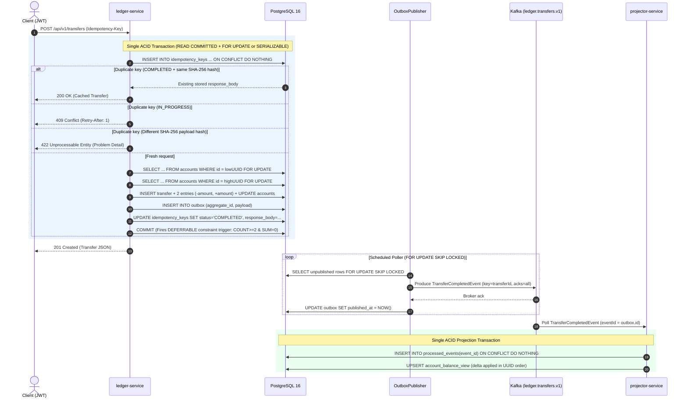
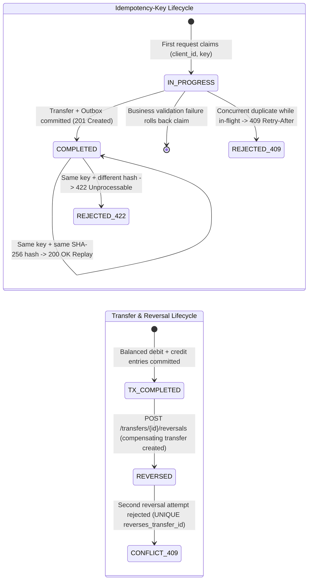

# Double-Entry Payments Ledger (`ledger-core`)


> **Disclaimer:** This repository is a portfolio demonstration system operating exclusively on synthetic test data and generated test IBANs. It is not a real payment system, licensed financial institution, or production banking rail.

A Java 21 / Spring Boot 3.3 double-entry ledger service backed by PostgreSQL 16 and Apache Kafka. Every monetary amount is represented in exact ISO 4217 integer minor units (`long` + `Math.addExact`), journal entries are strictly append-only, every transfer sums to zero under a deferred PostgreSQL constraint trigger at `COMMIT`, transfers are protected by a client-scoped `Idempotency-Key` state machine, and committed events flow through a `FOR UPDATE SKIP LOCKED` transactional outbox into a deduplicating Kafka balance projector with offset-0 replay.

---

## 1. Architecture & Execution Flows

### 1.1 System Topology (`ledger-service` + `projector-service`)

```mermaid
flowchart LR
    Client(["REST Client<br/>(OAuth2 JWT: ledger:read / ledger:write)"])

    subgraph Ledger["ledger-service :8080 (Spring Boot 3.3 / JDBC)"]
        API["LedgerController<br/>(RFC 9457 Problem Details)"]
        COORD["TransferCoordinator<br/>(pessimistic | serializable)"]
        IDEM["IdempotentTransferService<br/>(SHA-256 request_hash)"]
        ENG["TransferEngine & ReversalService<br/>(Canonical UUID Lock Order)"]
        POLL["OutboxPublisher<br/>(FOR UPDATE SKIP LOCKED)"]
    end

    subgraph PG[("PostgreSQL 16")]
        T_IDEM[("idempotency_keys<br/>PK (client_id, key)")]
        T_ACC[("accounts<br/>CHECK (allow_negative OR balance >= 0)")]
        T_TX[("transfers<br/>UNIQUE (reverses_transfer_id)")]
        T_ENT[("entries<br/>Append-Only Trigger +<br/>Deferred SUM=0 Trigger")]
        T_OUT[("outbox<br/>Partial Index (published_at IS NULL)")]
        T_VIEW[("account_balance_view &<br/>processed_events")]
    end

    subgraph Broker["Apache Kafka (KRaft)"]
        TOPIC[["Topic: ledger.transfers.v1<br/>(acks=all, enable.idempotence=true)"]]
    end

    subgraph Projector["projector-service :8081"]
        CONS["TransferEventsKafkaConsumer<br/>(AbstractConsumerSeekAware offset-0 replay)"]
        PROJ["BalanceProjectorService<br/>(Transactional Dedup + Upsert)"]
        QRY["BalanceQueryController<br/>(GET /api/v1/balances/{id})"]
    end

    Client --> API --> COORD --> IDEM --> ENG
    IDEM -- "1. INSERT ON CONFLICT DO NOTHING" --> T_IDEM
    ENG -- "2. SELECT FOR UPDATE (lowUUID, highUUID)" --> T_ACC
    ENG -- "3. Insert transfer + 2 entries + balances" --> T_TX
    ENG --> T_ENT
    ENG -- "4. Insert TransferCompleted" --> T_OUT
    POLL -- "5. Poll unpublished (SKIP LOCKED)" --> T_OUT
    POLL -- "6. Publish & set published_at" --> TOPIC
    TOPIC -- "7. Consume / Replay from offset 0" --> CONS --> PROJ --> T_VIEW
    T_VIEW --> QRY
```

### 1.2 End-to-End Transfer, Deferred Invariant Check & Outbox Recovery Sequence



### 1.3 Idempotency & Transfer Reversal State Machines



---

## 2. Repository Module Layout

| Module / Path | Responsibility | Key Classes / Files |
| :--- | :--- | :--- |
| **`ledger-domain`** | Pure Java 21 domain model (zero Spring dependencies): exact minor-unit money, ISO 4217 currencies, mod-97 IBAN validation/generation, balanced transfer & entry invariants. | `Money`, `Currency`, `Iban`, `Account`, `Transfer`, `Entry`, `IdempotencyDecision` |
| **`ledger-service`** | OAuth2/JWT resource server, SHA-256 idempotency engine, canonical-lock / `SERIALIZABLE` transfer engine, reversals, keyset statements, and `SKIP LOCKED` outbox poller. | `LedgerController`, `TransferCoordinator`, `IdempotentTransferService`, `TransferEngine`, `ReversalService`, `StatementService`, `OutboxPublisher`, `V1__ledger_schema.sql` |
| **`projector-service`** | Kafka consumer for `ledger.transfers.v1`, transactional `processed_events` deduplication, `account_balance_view` projection, and thread-safe offset-0 topic replay. | `TransferEventsKafkaConsumer`, `BalanceProjectorService`, `BalanceQueryController`, `V1__projector_schema.sql` |
| **`deploy/` & `scripts/`** | Local Docker Compose infrastructure (`postgres:16-alpine`, `apache/kafka:3.8.0` KRaft, `prom/prometheus`) and reproducible benchmark/load-test runners. | `docker-compose.yml`, `prometheus.yml`, `benchmark-contention.sh`, `load-test.sh`, `demo.sh` |

---

## 3. Non-Negotiable Ledger Invariants (Database + Java)

| Invariant | Java Enforcement (`ledger-domain` / `ledger-service`) | PostgreSQL 16 Enforcement (`V1__ledger_schema.sql`) | Verified By |
| :--- | :--- | :--- | :--- |
| **Exact Minor Units** | `Money(long amountMinor, Currency)` using `Math.addExact` / `subtractExact` / `negateExact` | `BIGINT` on all monetary columns | `MoneyTest` (`jqwik` + overflow tests) |
| **Append-Only Journal** | No update/delete repository methods exist for `entries` | `BEFORE UPDATE OR DELETE` trigger (`trg_entries_append_only`) raising `SQLSTATE 55000` | `L1DatabaseConstraintsIT` |
| **Zero-Sum Balanced Transfers** | `Transfer` compact constructor requires `>= 2` entries summing to `0L` | `DEFERRABLE INITIALLY DEFERRED` constraint triggers on `entries` & `transfers` checking `COUNT(*) >= 2` and `SUM(amount_minor) = 0` at `COMMIT` | `L1DatabaseConstraintsIT`, `L2TransferEnginePropertyTest` |
| **Single-Currency Match** | `CurrencyMismatchException` across `Money`, `Account`, and `Transfer` | `BEFORE INSERT` trigger (`trg_entries_currency_match`) matching entry, account, and transfer currencies | `L1DatabaseConstraintsIT`, `L2TransferEngineIT` |
| **No Negative Customer Balances** | `Account.applyEntry` raises `InsufficientFundsException` (`HTTP 422`) | `CHECK (allow_negative OR balance_minor >= 0)` on `accounts` | `L2TransferEnginePropertyTest`, `L4ConcurrencyProofIT` |
| **Client-Scoped Idempotency** | `IdempotencyDecision` (`ReplayStoredResponse`, `RejectInFlight` `409`, `RejectPayloadMismatch` `422`) | `PRIMARY KEY (client_id, key)` on `idempotency_keys` + `UNIQUE (client_id, idempotency_key)` on `transfers` | `L3IdempotencyStormIT` (50 threads x 20 rounds) |
| **At-Most-Once Reversal** | `ReversalService` row lock + status check throwing `DuplicateReversalException` (`HTTP 409`) | `reverses_transfer_id UUID NULL UNIQUE` referencing `transfers(id)` | `L6ApiSecurityReversalsAndStatementIT` |

---

## 4. REST API, Security Scopes & Observability

### 4.1 Endpoints & RFC 9457 Error Contracts

| Service | Endpoint | Required JWT Scope | Success | RFC 9457 Problem Details Error Codes |
| :--- | :--- | :--- | :--- | :--- |
| `ledger-service` | `POST /api/v1/accounts` | `SCOPE_ledger:write` | `201 Created` | `400` invalid currency/IBAN mod-97, `401`/`403`, `409` duplicate IBAN |
| `ledger-service` | `GET /api/v1/accounts/{id}` | `SCOPE_ledger:read` | `200 OK` | `401`/`403`, `404` account not found |
| `ledger-service` | `POST /api/v1/transfers` | `SCOPE_ledger:write` + `Idempotency-Key` | `201 Created` / `200 OK` (replay) | `400` missing header/validation, `409` in-flight (`Retry-After`), `422` insufficient funds / currency mismatch / payload hash mismatch |
| `ledger-service` | `GET /api/v1/transfers/{id}` | `SCOPE_ledger:read` | `200 OK` | `401`/`403`, `404` transfer not found |
| `ledger-service` | `POST /api/v1/transfers/{id}/reversals` | `SCOPE_ledger:write` | `201 Created` / `200 OK` (replay) | `404` transfer not found, `409` already reversed, `422` insufficient funds |
| `ledger-service` | `GET /api/v1/accounts/{id}/statement?cursor=&limit=` | `SCOPE_ledger:read` | `200 OK` | `400` invalid limit (`1..1000`), `404` account not found |
| `projector-service` | `GET /api/v1/balances/{accountId}` | Public / internal read model | `200 OK` | `404` account not yet projected |

### 4.2 Prometheus Metrics (`/actuator/prometheus`)

| Metric Name | Type | Labels | Operational Signal |
| :--- | :--- | :--- | :--- |
| `ledger_transfers_total` | Counter | `outcome=completed\|replayed\|insufficient_funds\|rejected\|error` | Transfer throughput and business rejection rate |
| `ledger_transfer_duration_seconds` | Timer | — | End-to-end ACID transaction latency distribution |
| `ledger_idempotent_replays_total` | Counter | — | Client retry volume absorbed by the idempotency layer |
| `ledger_lock_retries_total` | Counter | — | PostgreSQL `SQLSTATE 40001` / `40P01` retries under `SERIALIZABLE` |
| `ledger_outbox_unpublished` | Gauge | — | Backlog of uncommitted/unrelayed outbox events |
| `ledger_outbox_publish_lag_seconds` | Timer | — | Delay between transfer commit and Kafka `acks=all` confirmation |
| `projector_events_total` | Counter | `outcome=applied\|duplicate` | Read-model projection rate vs. deduplicated redeliveries |

---

## 5. Quickstart

```bash
# 1. Run all unit tests, jqwik property tests, Testcontainers ITs, and JaCoCo 85%+ gate
mvn clean verify

# 2. Run the 50-thread idempotency storm + 100-thread / 20,000-transfer concurrency proof
./scripts/load-test.sh

# 3. Reproduce the Uniform vs. Hot-Account concurrency benchmark (updates ADR-0004)
./scripts/benchmark-contention.sh

# 4. Boot local PostgreSQL 16, Kafka (KRaft), and Prometheus and run verification demo
./scripts/demo.sh
```

---

## 6. Concurrency Proof & Measured Contention Benchmark

### 6.1 Concurrency & Reliability Verification Suite
- **20,000 Concurrent Transfers (`L4ConcurrencyProofIT`):** Executes `20,000` random transfers across `100` concurrent threads and `10` accounts (`1` `SYSTEM` funding account + `9` `CUSTOMER` accounts) under **both** `pessimistic` (`SELECT ... FOR UPDATE` in ascending UUID order) and `serializable` (`ISOLATION_SERIALIZABLE` with jittered `40001`/`40P01` retry) strategies, plus `10` consecutive contention rounds—asserting strict conservation of total money, zero negative customer balances, zero unbalanced entries, and zero deadlock/serialization errors surfaced to callers.
- **Idempotency Storm (`L3IdempotencyStormIT`):** Executes `20` consecutive rounds of `50` concurrent requests sharing the same `Idempotency-Key`, confirming exactly `1` committed transfer and `50` identical responses per round.
- **Outbox Crash & Projector Offset-0 Replay (`L5OutboxCrashIT`, `L5ProjectorReplayIT`):** Injects a publisher crash after Kafka broker acknowledgement and before setting `published_at`, proves at-least-once redelivery across concurrent `SKIP LOCKED` pollers, verifies duplicate suppression via `processed_events`, and rebuilds an identical `account_balance_view` by seeking all Kafka partitions back to offset `0`.

### 6.2 Pessimistic Lock Ordering vs. `SERIALIZABLE` Benchmark
*Environment: Intel(R) Core(TM) i3-1005G1 CPU @ 1.20GHz (4 vCPUs, 4.2Gi RAM, WSL2 Ubuntu, openjdk version 21.0.12.1 2026-08-18), Testcontainers PostgreSQL 16, 32 concurrent threads, 2,000 transfers per scenario.*

| Workload Profile | Strategy | Throughput | Elapsed Time | DB Retries (`40001`/`40P01`) |
| :--- | :--- | ---: | ---: | ---: |
| **Uniform (50 accounts)** | `pessimistic` (`SELECT FOR UPDATE`) | **283 tx/s** | 7061 ms | **0** |
| **Uniform (50 accounts)** | `serializable` (SSI + retry) | **266 tx/s** | 7514 ms | **1185** |
| **Hot-Account (1 hub + 19 spokes)** | `pessimistic` (`SELECT FOR UPDATE`) | **211 tx/s** | 9462 ms | **0** |
| **Hot-Account (1 hub + 19 spokes)** | `serializable` (SSI + retry) | **29 tx/s** | 67351 ms | **16800** |

*(Note: Figures above are single-run measurements on the stated WSL2 laptop environment via `./scripts/benchmark-contention.sh`. Unsuccessful transfer attempts that roll back on business validation, such as `InsufficientFundsException`, also roll back their `idempotency_keys` slot so callers can retry after funding; successful transfers permanently bind `(client_id, key)` to the stored response.)*

---

## 7. Architecture Decision Records (ADRs)

- [**ADR-0001: Integer Minor Units Instead of Decimals**](docs/adr/0001-integer-minor-units-over-decimals.md)
- [**ADR-0002: Append-Only Entries with Account Balance Column & Deferred Triggers**](docs/adr/0002-append-only-entries-with-account-balance-column.md)
- [**ADR-0003: Idempotency State Machine (`client_id`, `key`, `request_hash`)**](docs/adr/0003-idempotency-state-machine.md)
- [**ADR-0004: Canonical Lock Ordering (`SELECT FOR UPDATE`) vs. `SERIALIZABLE` Retries**](docs/adr/0004-lock-ordering-and-pessimistic-vs-serializable.md)
- [**ADR-0005: Transactional Outbox (`FOR UPDATE SKIP LOCKED`) Over Dual Writes**](docs/adr/0005-transactional-outbox-vs-dual-writes.md)
- [**ADR-0006: Explicit JDBC and SQL Over JPA on the Transfer Hot Path**](docs/adr/0006-jdbc-and-explicit-sql-for-transfer-path.md)

---

## 8. Future Scope: Architecture at 100x Scale

1. **Sub-Account Sharding for Hot Settlement Accounts:** Even with canonical `SELECT ... FOR UPDATE` (`0` retries), a single merchant or platform `FUNDING` account serializes on one PostgreSQL row lock (~211 tx/s on laptop hardware). Striping a hot logical account across $N$ physical sub-accounts (`account_shards`, e.g., $N = 16$) selected by hashing `transfer_id` increases hot-account write concurrency linearly while preserving exact balance conservation across the shard sum.
2. **PostgreSQL WAL Change Data Capture (Debezium Logical Decoding) Over Outbox Polling:** Replacing the scheduled `FOR UPDATE SKIP LOCKED` SQL poller with PostgreSQL logical replication (`pgoutput` via Debezium) eliminates polling read/update amplification on the primary database while keeping sub-100ms event delivery latency.
3. **Time-Partitioned `entries` and `outbox` Tables (`PARTITION BY RANGE (created_at)`):** Partitioning append-only `entries` and `outbox` tables monthly allows instant retention management (`DROP TABLE` / detach partition on old published outbox slices instead of `VACUUM`-heavy `DELETE`s) and keeps active B-Tree indexes resident in `shared_buffers`.
4. **Asymmetric JWKS Key Rotation & mTLS:** Replace the static development HS256 secret with OIDC JWKS RS256/ES256 public-key discovery and workload-identity mTLS between `ledger-service` and `projector-service`.
